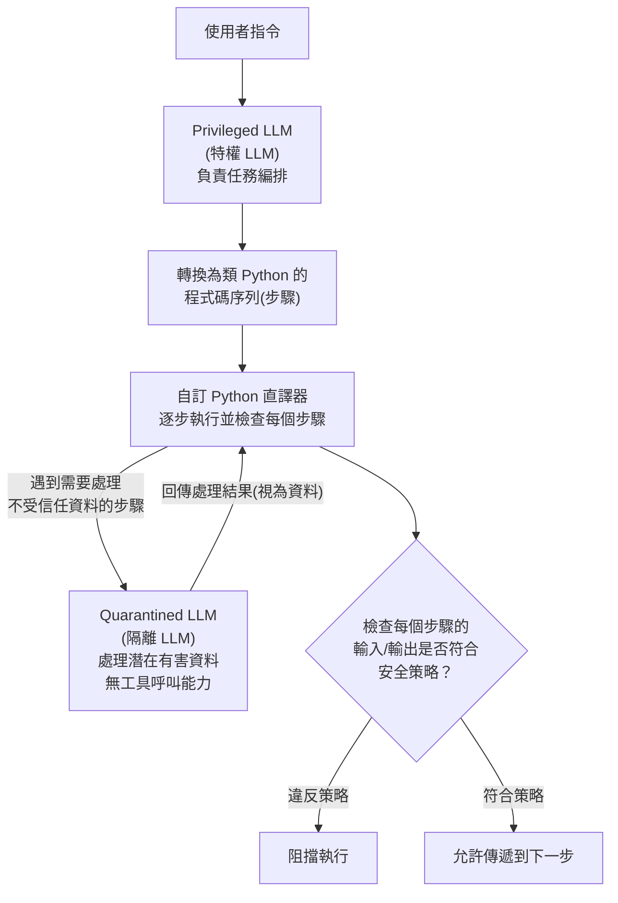

> 整理自 Google DeepMind 論文〈Defeating Prompt Injections by Design〉(arXiv:2503.18813，提出 CaMeL 框架)，補充架構說明，方便日後查閱與比較其他系統層級（system-level）防禦框架。

## 1. CaMeL 是什麼

CaMeL（CApabilities for MachinE Learning）是 Google DeepMind 提出的一套**系統層級（system-level）防禦框架**，用來對抗提示注入（prompt injection）攻擊。它最大的特色是**不需要重新訓練或修改既有的 LLM**，而是在 LLM 外部建立一層保護，透過**原則性的系統設計（principled system design）**——而非模型調校或輸入過濾——來達成安全性，號稱是第一個對提示注入攻擊提供**形式化安全保證（formal security guarantees）** 的架構層級防禦。

在論文〈Taming Privilege Escalation in LLM-Based Agent Systems〉中，CaMeL 與 [[IsolateGPT]] 一同被歸類為**系統層級**防禦框架的代表，也就是借鑑傳統系統安全思路、採用隔離機制來控制資訊可存取性，有別於檢測層級框架（如 [[Llamafirewall]]、[[PromptArmor]]，仰賴輔助模型偵測）與模型層級框架（如 [[SecAlign]]、[[Instruction Hierarchy]]，透過微調強化模型穩健性）。

## 2. 核心架構：雙模型 + 自訂直譯器

CaMeL 採用**雙模型架構**：

- **Privileged LLM（特權 LLM）**：負責任務編排，將使用者指令轉換為一連串類 Python 語言的執行步驟，並隔離敏感操作。
- **Quarantined LLM（隔離 LLM）**：負責處理可能包含惡意內容的不受信任資料，但**不具備工具呼叫能力**，因此即使被注入指令也無法直接執行任何動作。

透過一個**自訂 Python 直譯器**逐步執行這些步驟，並在每一步檢查輸入與輸出，確保資料只會被傳遞到正確的地方——這使得**控制邏輯（control logic）與不受信任的自然語言輸入（untrusted data）被嚴格分離**：不受信任的資料不能直接影響程式的控制流程（control flow），只能被當作資料本身處理。

## 3. 關鍵優勢

- 套用安全策略後，CaMeL 對多數模型可達到 **0 次成功的提示注入攻擊**。
- 安全性不是來自模型訓練技巧，而是來自圍繞語言模型的**系統設計原則**。
- 提供架構層級的**形式化安全保證**，而非僅依賴經驗式的輸入過濾或模型微調。

## 4. 在權限提升（Privilege Escalation）脈絡下的定位

〈Taming Privilege Escalation〉論文將 CaMeL 與 IsolateGPT 並列為系統層級防禦的代表，肯定其透過隔離機制取代機率性偵測的方向；但論文也指出，現有系統層級框架（包括 CaMeL）普遍存在**實用性侷限**：多數框架的防禦覆蓋範圍有限，主要僅針對簡單的間接提示注入攻擊，未能應對更廣泛的攻擊向量（例如論文定義的五種攻擊向量中的 RAG 投毒、不受信任代理、困惑代理人攻擊等）；此外，這類框架往往僅限於**單次代理—工具互動**，忽略了複雜多輪對話以及日益普及的多代理系統（MAS）中所固有的關鍵安全隱患。這正是該論文提出 SEAgent（一種基於 [[屬性型存取控制（ABAC）]] 的強制存取控制 MAC 框架，可跨多輪、跨代理追蹤執行路徑）的動機之一。

---

來源：
- Google DeepMind，〈[Defeating Prompt Injections by Design](https://arxiv.org/abs/2503.18813)〉(arXiv:2503.18813)
- Simon Willison，〈[CaMeL offers a promising new direction for mitigating prompt injection attacks](https://simonwillison.net/2025/Apr/11/camel/)〉
