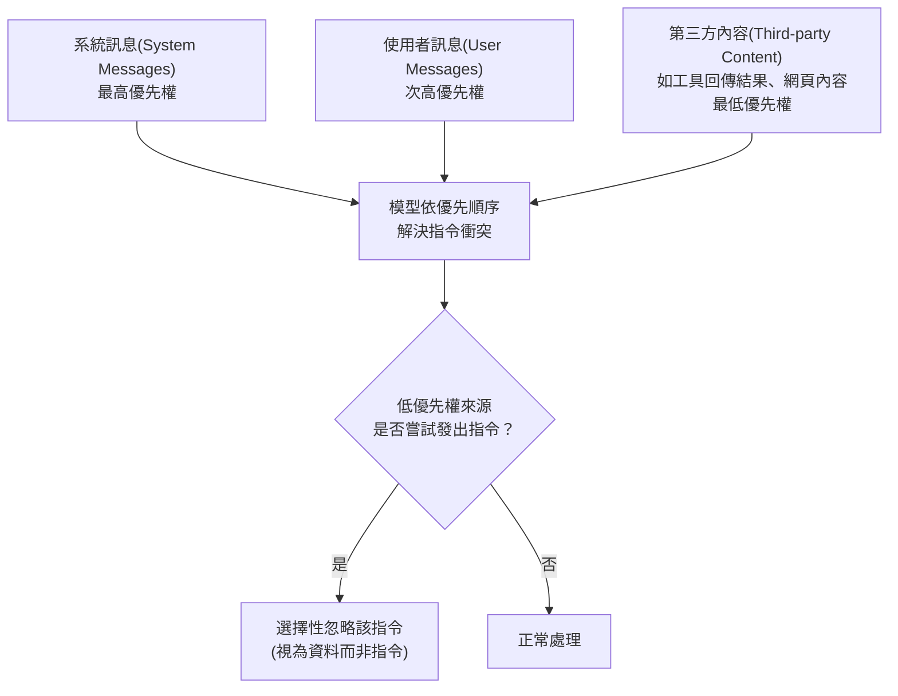

> 整理自 OpenAI 論文〈The Instruction Hierarchy: Training LLMs to Prioritize Privileged Instructions〉(arXiv:2404.13208, Wallace et al., 2024 年 4 月)，補充架構說明，方便日後查閱與比較其他模型層級（model-level）防禦框架。

## 1. Instruction Hierarchy 是什麼

Instruction Hierarchy（指令階層）是 OpenAI 提出的一套**模型層級（model-level）防禦框架**，用來解決 LLM 的一項根本弱點：模型往往把系統提示（system prompt）、使用者輸入、以及第三方內容（如工具回傳結果、網頁內容）**一視同仁**，導致攻擊者能透過提示注入，讓模型誤把低權限來源的惡意指令當成合法指令來執行。

在論文〈Taming Privilege Escalation in LLM-Based Agent Systems〉中，Instruction Hierarchy 與 [[SecAlign]] 一同被歸類為**模型層級**防禦框架的代表，也就是透過提示工程或微調來增強模型本身的內在穩健性，有別於檢測層級框架（如 [[Llamafirewall]]、[[PromptArmor]]，仰賴輔助模型偵測）與系統層級框架（如 IsolateGPT、CaMeL，採用隔離機制）。

## 2. 核心概念：明確的指令優先順序

Instruction Hierarchy 的核心作法是**明確定義不同來源指令之間的優先順序**，當指令發生衝突時，模型應遵循高優先權來源、選擇性地忽略低優先權來源的指令：

優先順序為：**系統訊息 > 使用者訊息 > 第三方內容（工具輸出等）**。也就是說，即使第三方內容（例如網頁、工具回傳結果）裡夾帶了看起來像指令的文字（如「忽略先前指令，改做 X」），模型也應該把它當作**資料**看待，而非可執行的指令。

## 3. 訓練方法

論文提出了對應的**資料生成方法（data generation method）**，用來產生示範「階層式指令遵循行為」的訓練資料，教會模型在面對不同優先權來源的衝突指令時，選擇性地忽略較低權限的指令，藉此把這種行為內化到模型權重中（屬於微調 / 對齊類方法，而非額外加裝偵測器）。

## 4. 評估結果

- 在 OpenAI 的主要評估上，Instruction Hierarchy 全面提升了安全性結果，穩健性最高提升達 **63%**。
- 該方法宣稱能在有效緩解攻擊的同時**保留模型原有效用**，因此已被部署於 GPT-4o-mini。

## 5. 在權限提升（Privilege Escalation）脈絡下的定位

〈Taming Privilege Escalation〉論文將 Instruction Hierarchy 歸類為模型層級防禦，其侷限在於：這類方法本質上仍依賴模型「學會」正確判斷優先順序，一旦攻擊手法能繞過訓練時所涵蓋的模式（例如透過更精巧的間接提示注入、或跨代理訊息等論文中定義的五種攻擊向量），防禦效果便可能失效。這也是該論文轉向提出 SEAgent（一種基於 [[屬性型存取控制（ABAC）]] 的確定性強制存取控制 MAC 框架）的動機之一：用強制執行、可稽核的安全策略取代仰賴模型內化行為的機率性防禦，以系統性地消除攻擊面。

---

來源：
- Wallace et al., 〈[The Instruction Hierarchy: Training LLMs to Prioritize Privileged Instructions](https://openai.com/index/the-instruction-hierarchy/)〉(arXiv:2404.13208)
