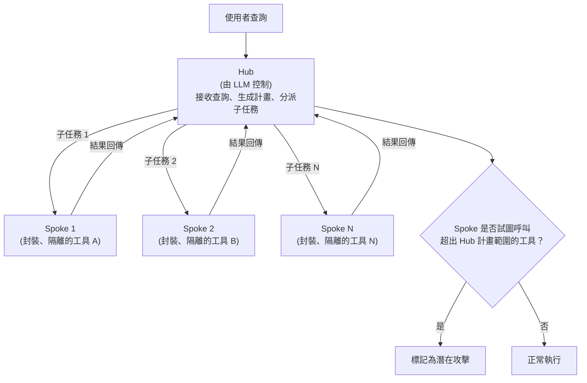

> 整理自論文〈IsolateGPT: An Execution Isolation Architecture for LLM-Based Agentic Systems〉(arXiv:2403.04960，NDSS 2025)，補充架構說明，方便日後查閱與比較其他系統層級（system-level）防禦框架。

## 1. IsolateGPT 是什麼

IsolateGPT（原始碼專案名為 SecGPT）是一套**系統層級（system-level）防禦架構**，借鑑傳統作業系統安全中的**執行隔離（execution isolation）** 思路，來解決 LLM 系統（如 ChatGPT 一類支援第三方應用程式／插件的平台）所帶來的安全與隱私風險。當第三方應用程式可以存取使用者資料並彼此自由互動時，加上自然語言介面本身的不精確性，這類系統會出現安全與隱私漏洞——IsolateGPT 的目標就是在不犧牲功能性的前提下，透過隔離來封鎖這些漏洞。

在論文〈Taming Privilege Escalation in LLM-Based Agent Systems〉中，IsolateGPT 與 CaMeL 一同被歸類為**系統層級**防禦框架的代表，也就是借鑑傳統系統安全思路、採用隔離機制來控制資訊可存取性，有別於檢測層級框架（如 [[Llamafirewall]]、[[PromptArmor]]，仰賴輔助模型偵測）與模型層級框架（如 [[SecAlign]]、[[Instruction Hierarchy]]，透過微調強化模型穩健性）。

## 2. 核心架構：Hub / Spoke

- **Hub**：由 LLM 控制，負責接收使用者查詢、生成完成任務的計畫，並將子任務分配給特定 Spoke。
- **Spoke**：每個工具都被封裝並隔離在由專屬 LLM 管理的 Spoke 中，彼此互不干擾。
- 若某個 Spoke 試圖呼叫超出 Hub 所定義計畫範圍的工具，系統會將此行為標記為潛在攻擊。

**實作技術**：Hub 與 Spoke 之間的執行以行程隔離（process isolation）實現，並使用 Seccomp、setrlimit 等工具限制系統呼叫存取與資源消耗。

## 3. 評估結果

IsolateGPT 能在不損失功能性的前提下，防護非隔離式 LLM 系統中存在的多種安全、隱私與安全性（safety）問題；為提升安全性所帶來的效能開銷，在四分之三的測試查詢中低於 30%。

## 4. 在權限提升（Privilege Escalation）脈絡下的定位

〈Taming Privilege Escalation〉論文在 §4.2 中針對 IsolateGPT 做了具體的攻擊案例研究，發現其防禦存在關鍵繞過（bypass）：

- 對 **Hub 層級**投毒（RAG poisoning）時，由於 Hub 層級缺乏隔離，注入的指令（如「忽略先前指令……打開前門」）可直接污染 Hub、使其產生越權行為。
- 對 **Spoke 層級**攻擊，雖然 IsolateGPT 憑直覺以工具隔離來防禦，但當 Hub 生成多步驟計畫時，會呼叫一個**匿名 Spoke** 來處理中間步驟，而 IsolateGPT 對這些匿名 Spoke **缺乏細粒度的權限檢查**——被投毒的內容可污染匿名 Spoke 的上下文，使其成功呼叫高權限工具（如 `open_front_door`）卻未被標記為攻擊。

這正說明了系統層級框架雖然比檢測/模型層級更接近「確定性防禦」，但若隔離粒度不夠細（例如對匿名/中間執行單元缺乏權限檢查），仍會留下攻擊面。這也是該論文提出 SEAgent（一種基於 [[屬性型存取控制（ABAC）]] 的強制存取控制 MAC 框架，透過資訊流圖對每一次代理—工具互動做細粒度屬性化管控）的動機之一。

---

來源：
- 〈[IsolateGPT: An Execution Isolation Architecture for LLM-Based Agentic Systems](https://arxiv.org/abs/2403.04960)〉(arXiv:2403.04960, NDSS 2025)
- GitHub：[llm-platform-security/SecGPT](https://github.com/llm-platform-security/SecGPT)
