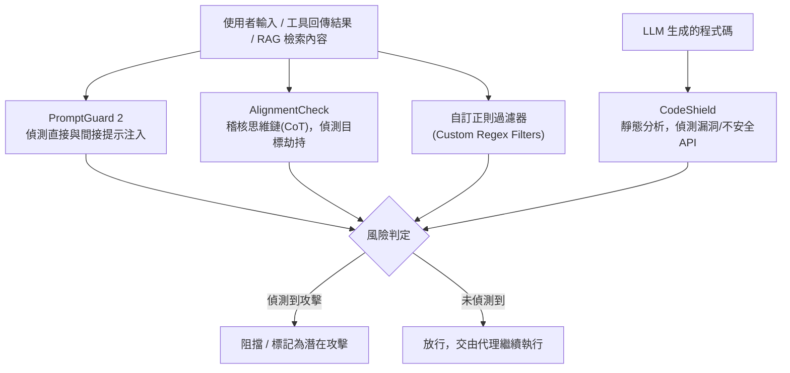

> 整理自 Meta AI 論文〈LlamaFirewall: An open source guardrail system for building secure AI agents〉(arXiv:2505.03574) 與官方文件，補充架構說明，方便日後查閱與比較其他偵測層級（detection-level）防禦框架。

## 1. LlamaFirewall 是什麼

LlamaFirewall 是 Meta 推出的開源安全防護框架（guardrail system），目標是成為 LLM 代理世界的「Snort / Zeek」——一套模組化、即時運作的系統，用來偵測並緩解以 AI 為核心的安全風險。它與傳統只針對「有毒內容」做過濾的內容審核工具不同，LlamaFirewall 提供的是**系統層級（system-level）防禦**，專為現代代理式（agentic）應用場景設計，例如程式碼生成、工具編排（tool orchestration）與自主決策。

在論文〈Taming Privilege Escalation in LLM-Based Agent Systems〉中，LlamaFirewall 被歸類為**檢測層級（detection-level）** 防禦框架的代表之一（與 PromptArmor 並列），意即它主要透過輔助模型（auxiliary models）即時掃描輸入輸出，來識別潛在攻擊，而非像系統層級框架（如 IsolateGPT、CaMeL）那樣採用隔離機制，也不像模型層級防禦（如 SecAlign）那樣透過微調強化模型本身的穩健性。

## 2. 架構設計

LlamaFirewall 採**分層防禦（layered defense）** 架構，在代理的整個運作生命週期中串接多個掃描器（scanner），可同時處理多層輸入輸出。設計上強調低延遲，以適應高吞吐量的正式環境（production pipeline）即時運作需求。

## 3. 核心元件

| 元件 | 功能說明 |
|---|---|
| **PromptGuard 2** | 即時越獄（jailbreak）與提示注入偵測器。提供 86M 與 22M 兩種參數規模的模型，可偵測直接與間接提示注入，官方數據顯示在 1% 誤報率下可達 97.5% 召回率（recall）。 |
| **AlignmentCheck** | 思維鏈（chain-of-thought）稽核器，即時監控代理的推理過程，在代理實際執行動作前就攔截「目標劫持」（goal hijacking）等偏離使用者意圖的行為。 |
| **CodeShield** | 針對 LLM 生成程式碼的靜態分析器，可延伸擴充規則，偵測安全漏洞、不安全的 API 使用與違反內部政策的程式碼。 |
| **自訂正則過濾器** | 讓使用者依組織自身需求，定義特定的樣式比對規則，用來偵測客製化的威脅。 |

## 4. 涵蓋的三大安全面向

1. **提示注入偵測**：同時涵蓋直接提示注入（惡意使用者輸入）與間接提示注入（透過工具回傳結果、外部內容等媒介注入的惡意指令）。
2. **推理過程稽核**：即時稽核代理的思維鏈，在錯誤行為發生前先行預防，而非事後補救。
3. **程式碼安全掃描**：在部署前掃描代理生成的程式碼，找出潛在漏洞。

## 5. 應用場景與定位

LlamaFirewall 鎖定的是現代代理式工作流程，包括程式碼生成、工具編排、自主決策等傳統內容審核工具難以應對的情境，目前已於 Meta 內部正式環境中實際部署使用。作為開源專案，它強調透明度與社群共同強化防禦能力，允許團隊稽核並依威脅演進持續擴充規則。

## 6. 在權限提升（Privilege Escalation）脈絡下的定位

〈Taming Privilege Escalation〉論文指出，像 LlamaFirewall 這類依賴「機率性元件」（ML 偵測模型）的檢測層級防禦，本質上會引入新的攻擊面：研究顯示 ML-based 偵測器容易受到基於最佳化的對抗性攻擊（adversarial attacks）繞過。這也是該論文提出 SEAgent（一種基於 [[屬性型存取控制（ABAC）]] 的強制存取控制 MAC 框架）等**確定性系統層級防禦**的動機之一——用強制執行的安全策略取代機率性偵測，以消除額外的攻擊面。

---

來源：
- Meta AI，〈[LlamaFirewall: An open source guardrail system for building secure AI agents](https://arxiv.org/abs/2505.03574)〉(arXiv:2505.03574)
- 官方文件：[About LlamaFirewall](https://meta-llama.github.io/PurpleLlama/LlamaFirewall/docs/documentation/about-llamafirewall)
- GitHub：[meta-llama/PurpleLlama/LlamaFirewall](https://github.com/meta-llama/PurpleLlama/tree/main/LlamaFirewall)
