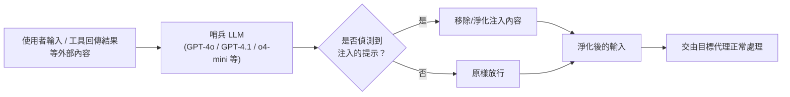

> 整理自論文〈PromptArmor: Simple yet Effective Prompt Injection Defenses〉(arXiv:2507.15219, Shi et al., 2025 年 7 月)，補充架構說明，方便日後查閱與比較其他偵測層級（detection-level）防禦框架。

## 1. PromptArmor 是什麼

PromptArmor 是一套「簡單卻有效」的提示注入（prompt injection）防禦機制。核心概念非常直接：**在代理實際處理輸入之前，先用另一個現成（off-the-shelf）的 LLM 去偵測並移除輸入中可能被注入的惡意提示**。它不需要客製化的偵測邏輯或額外訓練，而是把「偵測提示注入」這件事本身也交給一個強大的通用 LLM 來完成。

在論文〈Taming Privilege Escalation in LLM-Based Agent Systems〉中，PromptArmor 與 [[Llamafirewall]] 一同被歸類為**檢測層級（detection-level）** 防禦框架的代表，也就是透過輔助模型（auxiliary models）來識別潛在攻擊，而非像系統層級框架（IsolateGPT、CaMeL）採用隔離機制，也不同於模型層級防禦（SecAlign）透過微調強化模型本身的穩健性。

## 2. 運作方式

PromptArmor 的作法是在代理（agent）前面加裝一個「哨兵」LLM：

具體流程：以一段簡短的提示，詢問這個哨兵 LLM「這筆輸入資料中是否含有被注入的提示」，若偵測到，就將其移除後再交給下游代理處理。整個機制不需要修改代理本身，也不需要額外訓練專屬的偵測模型。

## 3. 評估結果

在 AgentDojo 基準測試上，使用 GPT-4o、GPT-4.1 或 o4-mini 作為哨兵模型時：

| 指標 | 結果 |
|---|---|
| 誤報率（False Positive Rate） | < 1% |
| 漏報率（False Negative Rate） | < 1% |
| 淨化後的攻擊成功率（ASR） | < 1% |

此外，該防禦在面對**自適應攻擊（adaptive fuzzing attacks）**——即攻擊者專門針對此防禦機制設計的攻擊——時依然保持有效。作者也測試了一個 320 億參數的開源模型作為哨兵，效果已相當接近前沿（frontier）閉源模型。

## 4. 關鍵論點與定位

作者主張，PromptArmor 推翻了先前「現成 LLM 無法被直接提示成有效提示注入防禦」的看法，並認為它可以作為：

- 一個**便宜、模組化的基準線（baseline）**，且會隨著前沿 LLM 能力提升而自動變得更好；
- 未來評估新防禦機制時的**標準比較基準**。

## 5. 在權限提升（Privilege Escalation）脈絡下的定位

〈Taming Privilege Escalation〉論文指出，像 PromptArmor、Llamafirewall 這類依賴「機率性元件」（用 LLM 或 ML 模型做偵測）的檢測層級防禦，本質上會引入新的攻擊面：研究顯示基於 LLM 的防禦在**級聯注入攻擊（cascading injection attacks)下可能失效——也就是當作為「防禦者」的哨兵 LLM 本身也被攻陷時。這也是該論文轉向提出 SEAgent（一種基於 [[屬性型存取控制（ABAC）]] 的確定性強制存取控制 MAC 框架）的動機之一：用強制執行的安全策略取代機率性偵測，以消除額外的攻擊面。

---

來源：
- Shi et al., 〈[PromptArmor: Simple yet Effective Prompt Injection Defenses](https://arxiv.org/abs/2507.15219)〉(arXiv:2507.15219)
