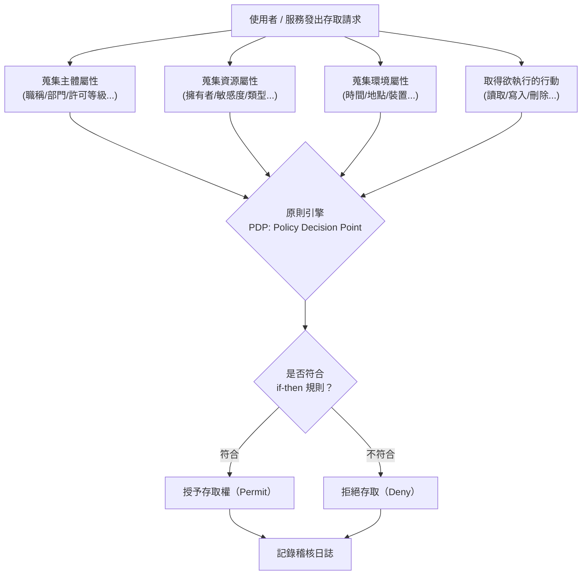
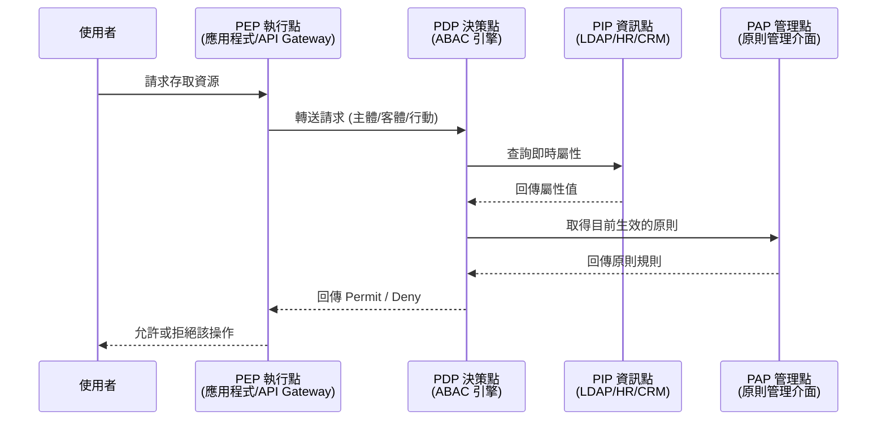
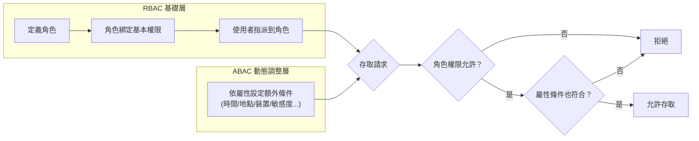

> 整理自 SailPoint 文章〈什麼是屬性型存取控制 (ABAC)？〉，並補充流程圖與延伸說明，方便日後查閱與比較兩種存取控制模型。

## 1. ABAC 是什麼

屬性型存取控制（Attribute-based Access Control, ABAC），也常被稱為原則型存取控制（PBAC）或聲明型存取控制（CBAC），核心概念是**不直接把權限綁在「角色」上，而是綁在一組可組合的屬性條件上**。系統用布林邏輯組出「if-then」規則，把「誰（Subject）」、「要做什麼（Action）」、「對什麼資源（Object）」、「在什麼情境下（Environment）」這四件事組合起來判斷。

例如：業務人員對 CRM 有讀寫權限，但同樣是要「檢視報表」的管理職，卻只給唯讀權限——差異不是靠「角色清單」硬編出來的，而是由屬性條件動態算出來的。

常見應用場景：

- 保護資料、網路、裝置、雲端服務與 IT 資源，避免未授權存取
- 保護微服務 / API，防止敏感交易被曝露
- 依「每個使用者」的情境動態調整防火牆規則

## 2. 組成 ABAC 決策的四類屬性

|屬性類別|說明|常見範例|
|---|---|---|
|主體（使用者）屬性|描述「誰」在發出存取請求|使用者名稱、員工 ID、職稱、部門、安全許可等級、管理階層|
|客體（資源）屬性|描述「被存取的東西」本身的特性|建立日期、最後更新時間、擁有者、檔案類型、資料敏感度|
|環境（情境）屬性|描述請求發生的「外在情境」|當下時間、地點、裝置類型、通訊協定、驗證強度、近 24 小時的行為模式|
|行動屬性|描述使用者想對資源做什麼|讀取、寫入、編輯、刪除、傳送、核准|

這些屬性通常來自不同系統：IAM、ERP、HR 系統、CRM、LDAP 目錄等，ABAC 引擎在判斷時會即時整合這些來源。

## 3. ABAC 的判斷流程

原文把 ABAC 的運作簡化為三步驟：發出請求 → 引擎比對屬性與原則 → 授予或拒絕。實際落地時，這個過程可以再拆解成更細的判斷鏈：

這其實對應到業界常見的 **PDP / PEP / PAP / PIP** 架構（策略決策點、執行點、管理點、資訊點），SailPoint 原文沒有明講，但理解這個分工有助於實作：

## 4. ABAC 的優勢

- **原則涵蓋範圍廣**：只要屬性和條件能用運算語言表達，幾乎任何情境都能建規則（例如「特定部門的人只能在上班時間、特定地點存取某類資料」）。
- **介面直觀**：技術細節被封裝起來，具權限者更新使用者檔案即可讓存取權跟著屬性自動調整，不需要逐一定義「使用者—資源」的對應關係。
- **加速新人 / 合作夥伴上線**：只要套用既有原則和屬性，不需重寫規則就能授權新對象。
- **彈性高**：可存取的應用程式、資料類型、可執行的操作幾乎都能依情境動態調整。
- **有利法遵**：精細的權限控管有助滿足 HIPAA、GDPR、PCI DSS 等對個資與敏感資料保護的要求。
- **可擴充**：屬性與規則一旦建立完成，類似職位或元件可以直接複用，降低後續維運成本。

## 5. ABAC 的挑戰

初期建置成本高，需要投入：

1. 為每個元件（人、系統、資源）指派屬性
2. 建立中央原則引擎，定義「if X then Y」的條件邏輯
3. 完整定義所有屬性
4. 在規則定案前，先推演特定使用者最終會擁有哪些權限
5. 詳細規劃授權原則，確保規則集完整且不衝突

換句話說：ABAC 的長期維運很輕鬆，但前期的屬性盤點與原則設計是一項扎實的工程投資。

## 6. ABAC vs RBAC 對照

角色型存取控制（Role-based Access Control, RBAC）是另一種主流模型：**先定義角色，再把角色綁定權限，最後把使用者指派到角色**。

|面向|ABAC|RBAC|
|---|---|---|
|授權依據|屬性 + 原則（行動、資源特徵、位置、時間、請求方式…）|角色（預先定義好的權限組合）|
|決策方式|依情境動態運算|只看角色與其固定權限|
|原則表現|以個別屬性、自然語言、情境資訊構成|只依角色本身|
|維護方式|新增/移除/調整屬性即可，不必重寫原則|新角色需要手動定義|
|粒度|較細緻|較粗放，容易對整個群體授予過寬權限|

## 7. 該選 ABAC 還是 RBAC？

選擇主要看組織規模、預算與安全需求：

|適合 ABAC|適合 RBAC|
|---|---|
|有資源支撐較複雜的導入流程|需要存取控制但資源有限|
|使用者角色本身就很動態、數量龐大|組織內部群組定義清楚、穩定|
|組織持續快速成長|組織規模成長幅度不大|
|人力分散在多個地理區域|人力集中在單一據點|
|需要深入、精細的存取控制|可接受較粗放的存取原則即可|

## 8. 混合方案：ARBAC

實務上不必二選一。**ARBAC（Attribute-enhanced RBAC）** 結合兩者：用 RBAC 處理基本、穩定的角色權限（管理方便），再用 ABAC 補上動態、情境化的細部限制（彈性夠高）。

好處：

- IT 團隊可自動化基本存取（靠角色），業務單位可依需求疊加更貼近業務結構的限制（靠屬性）
- 設定角色與屬性的相依關係後，特定使用者的限制能自動套用，不需人工逐一設定
- 減少需要管理的使用者設定檔數量，簡化到職／離職流程
- 可支援風險調整型存取控制，並以互斥特權（mutually exclusive privileges）落實職能分離（SOD）

## 9. 小結

- ABAC＝「屬性 + 原則」動態決策，粒度細、彈性大，但前期建置成本高。
- RBAC＝「角色」靜態綁定權限，好理解、好上手，但角色一多容易失控（role explosion）。
- 大多數成熟組織的實務走向是 **ARBAC 混合模式**：用 RBAC 打底、用 ABAC 補強情境判斷，兼顧治理效率與精細度。

---

來源：SailPoint〈[什麼是屬性型存取控制 (ABAC)？](https://www.sailpoint.com/zh-hant/identity-library/what-is-attribute-based-access-control)〉，內容經摘要改寫並補充流程圖。